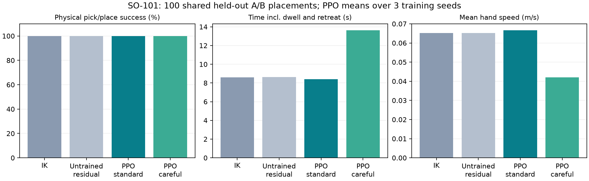
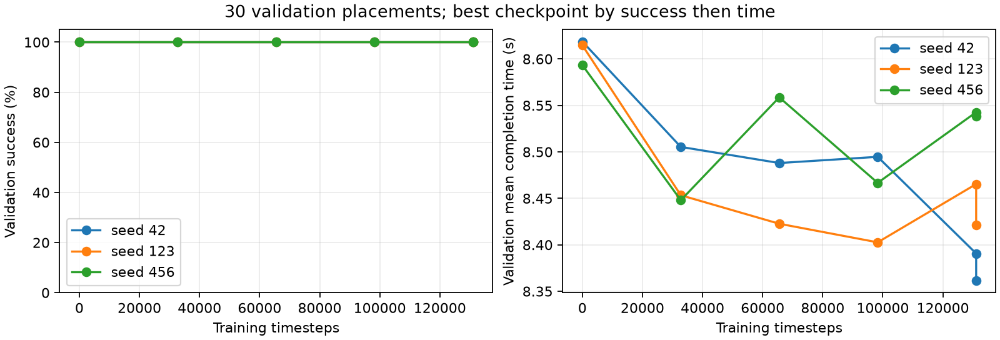

# 日本語で動作条件を変えるSO-101の物理把持・運搬

2026-10-23。SO-101のMuJoCoシミュレーションであり、実機の検証ではない。

## 目的と独自の工夫

A地点に置いた35g・一辺36mmの立方体へ近づき、指でつかんで持ち上げ、B地点へ運んで離す。同じ物体・配置・学習済み重みで、日本語指示に応じて関節の速度・指令変化量制限を切り替える。実在するSO-101のメッシュ・関節・サーボ・重力・接触モデルを用いる。

## 学習した部分と設計した部分

- モデル: MuJoCo Menagerieのrobotstudio_so101、コミットcda5236f98383f6fbaa4820c6b18dba892cd087f。Apache-2.0のライセンスと元ファイルを保存し、動的物体や作業机は別コードで追加した。
- IKが8つの経由姿勢を計算し、状態機械が近接・下降・把持・持ち上げ・運搬・下降・解放・退避を進める。グリッパーの開閉はルール制御。
- PPOは5関節の基準追従速度を最大±35%補正する残差制御。観測43次元に目標関節誤差、サーボ遅れ、関節状態、指令状態、作業段階、物体相対位置、モード制限を含む。把持全体をゼロから学習した方式ではない。
- 日本語をローカルQwen2.5:1.5Bがcareful/fastへ分類。1指示に1回だけ実行し、制御ループ外で設定する。不正出力・通信失敗はcarefulへフォールバックし、実LLM成功と区別する。
- carefulは関節速度指令0.4rad/s・指令加速度0.8rad/s²、standard/fastは1.2・3.0。同じ重みを使う。物理的な速度・加速度や実機安全を保証する制約ではない。

## 物理的把持と成功条件

物体はMuJoCoの自由剛体。移動中に物体の座標を書き換えず、溶接拘束も使わない。両指の接触を伴う状態で物体中心が6cmを超えることを記録する。8段階を終え、物体をB地点の半径3.5cm以内へ下ろし、指を開いて接触を離し、物体中心が高さ1〜3.5cmかつ速度0.03m/s未満で静止した場合を成功とする。物体の初期中心高さは1.8cm。

## 実験設計

学習128配置、検証30配置、最終評価100配置のseedを分離した。独立に初期化した学習seedは42/123/456。各131,072ステップ、合計393,216ステップ、CPU学習の実測時間合計566.74秒。PPOはMLP64×64、lr3e-4、n_steps512、batch128、4つの逐次ベクトル環境。保存と復元後の決定的行動一致を確認した。

検証成功率が最大、同率なら完了時間が短い重みを選ぶ。最終評価前にモデルのhashと条件をprotocol.jsonへ固定した。動画の学習seed42と最終評価先頭のケースを使用し、最終評価を見てデモ用モデルを選ばない。

全方式に同じ100配置を使う。同じ配置を3つの学習seedで繰り返すため、300個の独立した配置とは扱わない。standardとfastの定数は同じであり、別の高速方策を学習したわけではない。

## 全試行の実測結果

|方式|成功率|全試行平均時間|平均手先速度|
|---|---:|---:|---:|
|ik|100.0%|8.603s|0.0652m/s|
|random_residual|100.0%|8.501s|0.0676m/s|
|ppo_seed42_standard|100.0%|8.354s|0.0665m/s|
|ppo_seed42_careful|100.0%|13.680s|0.0421m/s|
|ppo_seed42_fast|100.0%|8.354s|0.0665m/s|
|ppo_seed123_standard|100.0%|8.390s|0.0675m/s|
|ppo_seed123_careful|100.0%|13.544s|0.0424m/s|
|ppo_seed123_fast|100.0%|8.390s|0.0675m/s|
|ppo_seed456_standard|100.0%|8.445s|0.0661m/s|
|ppo_seed456_careful|100.0%|13.707s|0.0415m/s|
|ppo_seed456_fast|100.0%|8.445s|0.0661m/s|
|ik_careful|100.0%|13.845s|0.0414m/s|
|untrained_residual|100.0%|8.622s|0.0652m/s|

## 結果の解釈

IKだけでも成立する課題であり、学習なしの基準制御も提示する。PPOを導入したこと自体を性能向上の証拠にしない。PPO・モード間の差は上の実測値で判断する。全試行平均時間は把持や解放の待機・退避を含み、失敗試行も含む。手先速度も待機を含む全ステップ平均。成功率100%であっても、この限定した100配置で失敗がなかったという意味であり、任意の配置での成功を保証しない。

## 限界

固定した開始姿勢、既知寸法の立方体、狭いA/B範囲、既知の物体座標だけの検証。カメラ画像からの認識、任意形状、未知位置の探索、実機転移は実装していない。手首可動範囲から、物体の持ち上げ高さも限定される。慎重モードという名前は安全保証を意味しない。

## 出典と再現

https://github.com/google-deepmind/mujoco_menagerie/tree/main/robotstudio_so101

モデルとライセンスはassets/so101/upstream、固定版と各ファイルhashはassets/so101/source.json。MuJoCo、Gymnasium、Stable-Baselines3、PyTorch、Ollama、Qwen、ImageIO等を使用。依存はrequirements-lock.txt。手順はREADME-SO101.mdを参照。

テストは42件通過。クラウドGPUは未使用、0時間・0USD。ローカル電気代は未計測。GitHub公開・YouTube投稿・OmniCampus提出はまだ行っていない。
